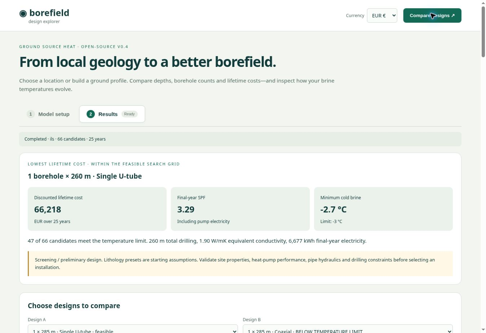
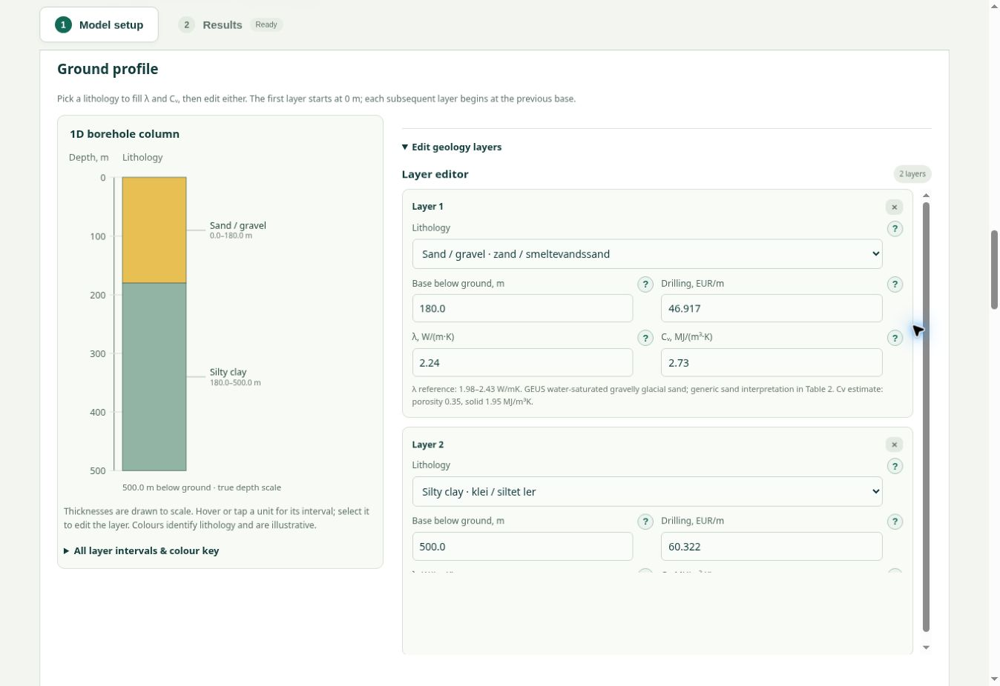
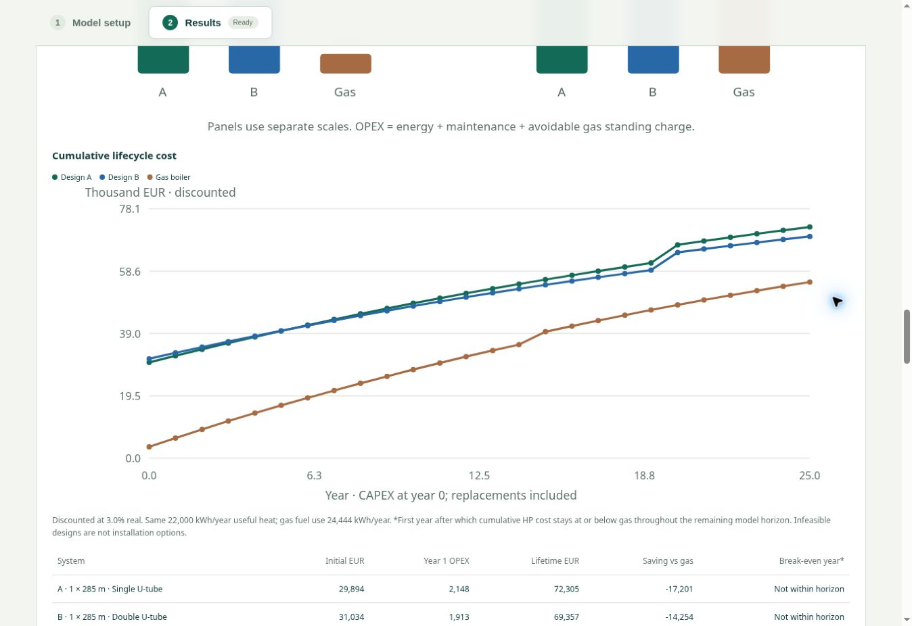
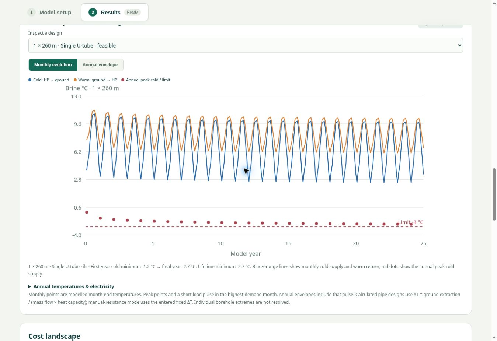

# Borefield Explorer

**From a building’s heat demand and local geology to a comparison of borehole layouts, heat-pump performance and lifetime costs.**

Borefield Explorer is an open-source, browser-based tool for screening closed-loop ground-source heat-pump systems. Explore whether one deep borehole or several shallower holes offer a better balance of brine temperatures, drilling costs and operating costs—and compare U-tube and coaxial constructions using the same assumptions.

**[Try the live tool →](https://floriansmit.github.io/borefield-design/)** · [Methods and data](public/api-docs.html) · [MIT licence](LICENSE)

*Illustrative 25-year calculation with 22,000 kWh/year delivered heat and an editable sand-over-clay profile. Results depend on the inputs and search bounds; the screenshots are examples, not installation recommendations.*

## Results from simple inspection to optimization

Results start with **one selected design**: a cost summary and component breakdown, brine temperatures, and sensitivity/spider diagrams. Next comes the **custom borefield comparison**, followed by **optimization and complete scenario packages**. Selecting a scenario for inspection updates its single-design summary and plots without replacing the baseline borefield comparison.

Financial results use standard locale-aware formatting with **two decimal places** in both EUR and DKK. Lifetime costs state the model period and discount rate and include energy, maintenance and replacements; they are distinct from annual OPEX. Construction and pump-check status are visible on optimization cards. Raw calculation and CSV values retain their numerical precision.

## Combine improvements in scenarios

Keep the current house as a baseline and add up to three named alternatives. Each alternative can combine an explicit total heat-demand reduction, a different heating-water temperature, a peak-demand assumption and a brine-flow choice, with an additional investment. Unchanged geology, energy prices and technical settings are inherited. Annual demand reductions preserve the monthly proportions, including hot water; peak demand stays unchanged unless explicitly changed.

Compare every package on the **same borefield**, or search for the **lowest discounted lifetime cost per scenario** using the configured borehole grid and construction choices. Optional flow optimization tests discrete flow settings and includes their effective resistance, pressure loss and pumping electricity. Enter a constant available-pressure limit or a pump curve in total field m³/hour versus available kPa; the curve is interpolated without extrapolation. Provisional exploration is clearly labelled as having unverified pump feasibility. Pump limits must refer to the same circuit boundary as the specified losses. This is not a pump-control simulation or installation certification.

Results show lifetime cost, initial investment, operating costs, temperature, drilling and flow, with cumulative cost curves and detailed temperature/cost inspection for each feasible scenario. Additional investment is counted once; shared maintenance/replacement assumptions remain in force. Savings and payback compare against the current-house heat-pump scenario; a separate gas curve uses baseline heat demand. Scenario settings travel with saved JSON inputs, and comparisons can be exported to CSV.

A visible explanation in Model setup explains why lower CV temperature can reduce electricity use yet increase ground extraction and drilling, while insulation reduces the actual heat required.

## Simple and advanced modes

Start in **Simple** mode with the house demand, heating temperature, location, borehole limits and energy prices. Expand **View assumptions** to review technical inputs, or switch to **Advanced** to open the detailed model, monthly loads, geology editor, pipe settings and search controls. Both modes use the same calculation engine and preserve all values when switching, including expert overrides loaded from JSON.

Record whether annual demand and peak load are estimated, derived from a gas bill or supported by measurements/calculations. The peak must represent the house heat requirement, rather than the boiler nameplate rating. A supply-temperature selector provides editable examples for underfloor heating and radiators. Gas can be entered per m³ using the billing conversion.

Simple results highlight up to three feasible alternatives with investment, first-year operating costs, minimum brine temperature and payback. Full temperature plots, selectable comparisons and sensitivity diagrams remain available.

## What you can explore

- **Borehole depth and count:** search combinations of equal-depth boreholes and rank temperature-feasible candidates by discounted lifetime cost. Add custom layouts outside the search grid, such as **1 × 285 m versus 2 × 180 m**.
- **Heat-exchanger construction:** compare **single U-tube, double U-tube and coaxial** designs together for every search and custom layout, or select one construction individually. Calculated modes account for pipe geometry, grout and brine properties, effective borehole resistance, circuit pressure losses, circulation electricity and installed loop cost. A manual resistance mode is also available.
- **Building heat demand:** enter annual delivered heat and peak heating load, or estimate them from floor area, heat loss and degree days, or a measured gas bill. Edit twelve named monthly heat demands in kWh; monthly totals and annual demand stay linked.
- **Ground conditions:** build an editable geological column with layer depths, lithology, thermal conductivity, volumetric heat capacity and drilling rates. Presets include typical Dutch/Danish lithologies with editable thermal starting values and evidence notes.
- **Location context:** select a map pin, enter coordinates or search a Dutch address. Preview and import a **TNO REGIS II** hydrogeological column, then review the inferred lithologies and any unclassified intervals.
- **Nearby registered systems:** switch on Dutch **open-system, closed-system and groundwater-abstraction overlays** from the public WKO/LGR service. Click markers for available registry details.
- **Optional regeneration:** enter twelve monthly ground-side heat-injection energies, with optional extra annual electricity and initial investment. A clearly labelled 4,000 kWh summer profile is available as an example. Regeneration is carried through lifetime brine temperatures, design feasibility and economics.
- **Gas price versus payback:** a full-width graph plots the actual gas tariff per m³ against sustained payback in whole years. Set your own price range, compare the base price with +20%, and export the sampled curve. Cases with no payback inside the project life are explicitly marked. The editable kWh/m³ gas conversion is visible beside the setup gas price and in the graph controls; changing it preserves the entered tariff per m³.
- **Sensitivity / spider diagrams:** vary gas price, electricity price and depth around a selected design, with payback and lifetime saving plotted separately. Depth points rerun the selected thermal and pipe models; unavailable or infeasible points are marked. Base tariffs can be changed beside the plots, with gas displayed per m³.
- **Lifetime performance and economics:** inspect brine temperatures across the project life, compare selected designs, and evaluate energy bills, maintenance and replacements against a gas-boiler reference.

The interface is available in **English and Dutch**. Use the language selector beside EUR/DKK; your choice is remembered in the browser. Labels, technical explanations, geology and result charts follow the selected language. Saved JSON inputs keep the same language-independent schema.

Technical inputs have **“?” explanations** with definitions, illustrative starting values and their effect on the calculation. Financial inputs and outputs support **EUR and DKK**, using an editable conversion rate.

## Geology you can see and edit

The 1D borehole column displays lithology colours and contacts on a true depth scale alongside the layer editor. Use a manually defined profile anywhere, or start with a Dutch REGIS import. Thermal properties remain editable because REGIS supplies hydrogeological geometry, not measured thermal conductivity or heat capacity.

The preset catalogue draws on GEUS thermal-property information for comparable lithologies. Heat-capacity defaults are separate engineering estimates. Unclassified REGIS units and gaps are identified for review rather than silently replaced with invented geology.

## Compare investment and running costs

Choose the two designs you want to compare. The results show initial **CAPEX**, first-year **OPEX**, and **cumulative lifecycle costs** against gas heating. Switch between discounted costs and undiscounted real costs; adjust energy tariffs, maintenance, equipment replacement intervals and avoidable gas standing charges.

The comparison also reports lifetime savings relative to gas and a sustained break-even year where one exists within the model horizon. Infeasible designs remain clearly labelled. Costs are scenario inputs, not live market quotations; subsidies and residual value are excluded.

## Follow brine temperatures through the system’s lifetime

Inspect a selected design’s cold supply and warm return temperatures month by month, or switch to an annual envelope. The plot includes the annual peak cold temperature and the chosen minimum-temperature limit, making seasonal cycling and long-term thermal drift visible.

The results include annual electricity use and seasonal performance factors with circulation electricity and any entered regeneration electricity. The loop ΔT field explicitly shows “Calculated by the model” in calculated pipe modes; monthly ΔT ranges and the largest modelled peak ΔT are reported in Results. Export temperature histories, candidate results and annual cost series as CSV; save and restore model inputs as JSON.

## A simple workflow

1. **Define demand:** enter measured heat demand or use the house estimator, then review peak load and the monthly distribution.
2. **Describe the site:** choose a location, import or enter geology, and check thermal properties and drilling costs.
3. **Choose the equipment and search:** select a heat exchanger, ground-response model, depth/count range, temperature limit and economic assumptions.
4. **Compare results:** inspect feasible designs, compare specific alternatives, review lifetime temperatures and test sensitivity to uncertain inputs.

## Calculation methods and scope

| Component | Approach |
| --- | --- |
| Ground thermal response | Fast infinite line source, or **pygfunction 2.3.1** finite-length g-functions with uniform borehole wall temperature (UBWT) or uniform heat extraction rate (UHTR) |
| Exchanger performance | pygfunction pipe models for U-tube/coaxial effective thermal resistance; simplified hydraulic losses and pumping electricity |
| Heat-pump performance | Iterated Carnot-based COP approximation with fixed temperature approaches, coupled to ground extraction |
| Heat loads | Twelve equal-duration monthly load steps repeated over the project life, plus an annual short-duration peak pulse |
| Economics | Depth-dependent drilling and loop costs, equipment/setup costs, annual electricity, maintenance and scheduled replacements; real discount and escalation rates |
| Execution | JavaScript calculations and a background worker; Python, NumPy, SciPy and pygfunction run locally in the browser through **Pyodide** |

No Python installation or calculation server is required. The Python runtime downloads on first use of a calculated pipe model or pygfunction ground engine. Address search, geology and map overlays depend on external public data services.

**This is a screening and preliminary comparison tool.** Geological layers are used to derive equivalent ground properties averaged over the drilled length; none of the ground engines resolves explicit layered heat transport or groundwater advection. A fixed buried-top-depth approximation is used for finite line sources. Heat-pump manufacturer performance maps, compressor capacity, backup heating, cooling equipment capacity and detailed control schedules are not modelled. Optional regeneration uses a prescribed ground-side injection profile and monthly net loads, with injection off during the heating peak. It does not calculate cooling COP, enforce maximum summer temperatures or credit cooling benefits against gas. Circuits use simplified, constant brine properties and balanced flow assumptions.

The cost search only covers the specified equal-depth layout grid. Property boundaries, drilling access, permitting constraints and thermal effects from neighbouring registered systems are not automatically enforced. Verify site properties, supplier data, hydraulics and applicable requirements before using a result to select an installation.

## Open source and development

Application code is **MIT licensed**. pygfunction, Leaflet and other dependencies retain their own licences; see [third-party notices](public/THIRD_PARTY_NOTICES.txt). Geological and map services retain their source attribution and terms, and registry coverage may be incomplete.

For local development, testing and optional hosting details, see [the development guide](docs/development.md).

### Pump selection and flow optimization

Enable model optimization and tick **Find the optimal brine flow** to search flow for every count/depth/exchanger combination. Alternatives inherit this setting; Advanced mode allows explicit overrides. The regular comparison and scenario search share a persistent worker, pipe kernels and a bounded result cache, avoiding a second Python startup. Disabled optimization hides its results section.

The source-linked pump library covers NIBE S1256, Bosch Compress 7800i LW, Viessmann Vitocal 300-G/333-G, Vaillant flexoTHERM, Stiebel Eltron WPE-I, alpha innotec WZSV, and Ecoforest ecoGEO. Profiles distinguish approximate digitized curves, conservative restricted ranges, isolated verified operating points and unavailable curves. These are **not interchangeable**. No extrapolation is used. Single-point profiles test only that total field flow, including it in the per-bore flow grid when it falls inside the entered bounds. Ecoforest profiles require a supplier curve; the older quoted unit cannot inherit the newer PRO curve.

See [pump data and limitations](docs/pump-profiles.md). Manufacturer selection does not replace the heat pump COP/capacity model. Pump electricity still uses entered hydraulic efficiency and operating hours and omits internal heat-pump hydraulic losses; optimized cost differences remain screening estimates.
